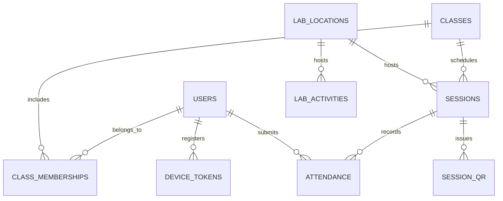
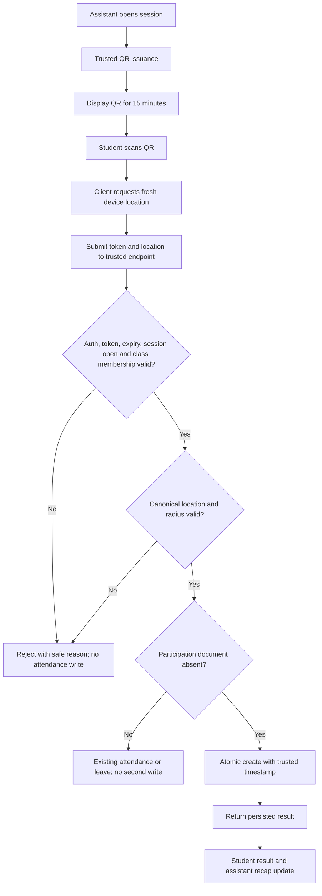

# LabCheckIn — Proposed Firestore Data Contract (Sprint 3)

**Status:** DRAFT — for team review; **not** an approved or deployed schema  
**Version:** 0.2  
**Source of requirements:** `LabCheckIn_Team_Agreement_Sprint_3.md`, especially Sections 3, 5, 7–10  
**Firebase project:** `labcheckin-58c73` (existing Sprint 2 project)  
**Owners:** Maulana (QR/attendance), Hasta (locations/maps), Jordan (FCM), Izzatu (permissions/error UX); PM Hanif coordinates cross-feature approval.

> **Important:** The Sprint 3 Agreement establishes minimum entities and invariants but explicitly does **not** finalize Firestore collection names, field names, document paths, or types. Everything in the **Proposed schema** sections below is a design proposal, pending read-only inspection of the actual deployed Sprint 2 repository, Firestore data, and Security Rules. The Sprint 2 agreement has now been cross-checked. Preserve existing collections and fields wherever possible. No migration or rules deployment is authorized by this document.

## 1. Scope and non-negotiable requirements

- S3-SRS-01–10: session QR generation, 15-minute expiry, scanning, validation of token/session/class/location, duplicate prevention, durable attendance, student result and assistant recap.
- S3-SRS-11–20: four location identities A–D, geotag administration, maps, device position, current/upcoming laboratory activity.
- S3-SRS-21–28: FCM device token lifecycle, relevant recipient selection, notification delivery and invalid-token handling.
- S3-SRS-29–36: permissions and consistent loading/empty/error/retry states across modules.
- Authentication and existing Sprint 2 class/session/attendance functionality must not be replaced.
- Session QR is issued only when session status is `open`; it expires **15 minutes after issuance** according to trusted/server time; a `closed` session invalidates it immediately.
- Attendance requires *all* checks: QR authenticity, matching session, open session, class membership, eligible current device location, and no prior attendance for the same user/session.
- Official names, coordinates, and radii of A–D **are not yet specified**. No example values may be treated as production data.
- QR payloads must not contain personal data or server secrets. Firestore is the system of record; notifications are not.

## 2. Proposed logical relationships



**Note:** `CLASS_MEMBERSHIPS` and `LAB_ACTIVITIES` are *logical* relationships, not instructions to create new collections. Prefer existing Sprint 2 membership and schedule structures; derive lab activities from sessions if possible. `SESSION_QR` may be a nested document or a restricted session field, subject to approval.

## 3. Proposed collection/field contracts

The paths below are **candidates only**. Verify existing names before adoption. `Timestamp` means Firestore Timestamp; `GeoPoint` means Firestore GeoPoint. IDs are strings unless the existing schema uses another stable convention. Fields labeled *optional* may be omitted; others are proposed minimums.

### 3.1 Users, classes, and membership — reuse Sprint 2

**Candidate existing paths:** `users/{uid}`, `classes/{classId}`; membership path `memberships/{classId}_{studentId}` as specified by Sprint 2 agreement.

| Logical field | Proposed type | Purpose |
|---|---|---|
| `uid` | string (Auth UID/document ID) | User identity; never trust a submitted UID as authorization |
| `role` | string | Existing Sprint 2 role, verified by Rules/backend |
| `classId` | string | Stable class identifier |
| `assistantId` (Sprint 2 canonical field) | string or existing representation | Assistant authorization |
| membership (`classId`, `studentUid`, active status) | existing representation | Verify student belongs to class |

**Decision:** Do not introduce a second membership list or rename existing role fields. Read actual data and Rules first.

### 3.2 Laboratory locations — Hasta owns canonical data

**Candidate path:** `labLocations/{locationId}` with stable IDs `A`, `B`, `C`, `D` (proposal; confirm actual IDs).

| Field | Type | Meaning |
|---|---|---|
| `name` | string | Official lab name, **TBD** |
| `coordinates` | GeoPoint | Official latitude/longitude, **TBD** |
| `radiusMeters` | number | Official permitted radius, positive, **TBD** |
| `isActive` | boolean | Whether location can be selected (optional) |
| `updatedAt` | Timestamp | Server-maintained audit timestamp |
| `updatedBy` | string | Authorized editor UID (optional) |

**Example shape only — deliberately no coordinates or radius:**

```json
{
  "documentPath": "labLocations/A",
  "name": "<OFFICIAL_NAME_PENDING>",
  "coordinates": "<FIRESTORE_GEOPOINT_PENDING>",
  "radiusMeters": "<OFFICIAL_RADIUS_PENDING>",
  "isActive": true,
  "updatedAt": "<SERVER_TIMESTAMP>"
}
```

The placeholder strings are **not valid production types**; this is an illustrative template, not seed data. Maulana's attendance validation and Hasta's Maps must read the **same** canonical location record, never separate hardcoded coordinates/radii.

### 3.3 Practicum sessions — reuse Sprint 2

**Candidate path:** `sessions/{sessionId}`; extend only if missing.

| Field | Type | Meaning |
|---|---|---|
| `classId` | string | Class reference |
| `assistantId` | string | Session owner, if not already derivable |
| `status` | string enum | At minimum `open` / `closed` as defined in Agreement; map other existing statuses |
| `locationId` | string | Reference to canonical lab location A–D |
| `startsAt`, `endsAt` | Timestamp | Schedule, if present in existing model |
| `updatedAt` | Timestamp | Server-maintained update time (optional) |

Do not rename or override existing session status semantics. Opening/closing a session must invalidate QR eligibility immediately as appropriate.

### 3.4 QR issuance and validity — Maulana

**Candidate path:** `sessions/{sessionId}/qrTokens/{qrId}` **OR** one restricted active-QR record per session. Choose one after reviewing the current schema and trusted backend.

| Field | Type | Meaning |
|---|---|---|
| `sessionId` | string | Bound session identifier |
| `tokenDigest` | string | Server-side digest of unpredictable token; raw token not stored in readable client documents |
| `issuedAt` | Timestamp | Trusted issuance time |
| `expiresAt` | Timestamp | Trusted `issuedAt + 15 minutes` |
| `revokedAt` | Timestamp/null | Explicit revocation, if applicable |
| `issuedBy` | string | Authorized assistant UID |

**Proposed QR payload:** `{ "v": 1, "sessionId": "<SESSION_ID>", "token": "<OPAQUE_RANDOM_TOKEN>" }`. The token is a bearer credential; do not log or expose it in general-purpose queries. Do **not** use a predictable session ID alone as proof of attendance.

**Proposed default:** only one active QR per session; issuing a replacement revokes the prior one. This is a recommendation in the Agreement, **not yet a finalized team decision**. Validation must check server time, current session status, token digest, session binding and revocation. The assistant's display receives the raw QR payload through a narrowly authorized trusted operation, not a public Firestore document.

### 3.5 Attendance — Maulana

**Sprint 2 contractual path (preserve):** `sessions/{sessionId}/participations/{studentId}`. Attendance and leave share this document, with `kind: attendance | leave`. The document ID is the authenticated student UID. Do not introduce a separate attendance collection without an explicit migration and team approval.

| Field | Type | Meaning |
|---|---|---|
| Field | Type | Meaning |
|---|---|---|
| `sessionId` | string | Session attended; matches parent path |
| `classId` | string | Canonical session class |
| `assistantId` | string | Canonical session/class owner |
| `studentId` | string | Authenticated student UID; matches document ID |
| `studentName` | string | Snapshot from membership |
| `studentNumber` | string or null | Snapshot from membership |
| `kind` | `attendance` | Existing Sprint 2 discriminator; leave uses `leave` |
| `createdAt`, `updatedAt` | Timestamp | Server audit timestamps |
| `checkedInAt` | Timestamp | Server-confirmed attendance time |
| `locationId` | string (new proposal) | Location used in QR/GPS validation |
| `validationMethod` | `qr_location` (new proposal) | Audit marker |
| `locationAccuracyMeters` | number (optional proposal) | Device-reported accuracy, not proof of physical presence |

**Example logical record** (timestamp placeholders are not literal Firestore strings):

```json
{
  "documentPath": "sessions/<SESSION_ID>/participations/<STUDENT_UID>",
  "sessionId": "<SESSION_ID>",
  "classId": "<CLASS_ID>",
  "assistantId": "<ASSISTANT_UID>",
  "studentId": "<STUDENT_UID>",
  "studentName": "<NAME_FROM_MEMBERSHIP>",
  "studentNumber": "<STUDENT_NUMBER>",
  "kind": "attendance",
  "createdAt": "<SERVER_TIMESTAMP>",
  "updatedAt": "<SERVER_TIMESTAMP>",
  "checkedInAt": "<SERVER_TIMESTAMP>",
  "locationId": "A",
  "validationMethod": "qr_location"
}
```

**Critical invariant:** Sprint 2 allows **one participation per student per session, either attendance or leave**. The QR backend must read this exact document and atomically create it only if absent; a pre-existing `kind: leave` must be rejected as `PARTICIPATION_CONFLICT`, not overwritten or converted to attendance. A pre-existing attendance is `ALREADY_CHECKED_IN`. This preserves Sprint 2 leave workflows, historical records, and Hanif's assistant recap without dual writes. Attendance remains immutable to clients.

**Existing recap query:** subscribe to `sessions/{sessionId}/participations`, filtering/rendering `kind: attendance` and separately summarizing leave states. Student history uses collection-group `participations` with `studentId == auth.uid` and `kind` as appropriate. Retain existing query/index behavior.

### 3.6 FCM device tokens — Jordan

**Candidate path:** `users/{uid}/deviceTokens/{deviceId}`; verify the actual token strategy and privacy model.

| Field | Type | Meaning |
|---|---|---|
| `token` | string | FCM registration token; restricted access |
| `platform` | string | `android` / `ios` (as supported) |
| `updatedAt` | Timestamp | Server-maintained update time |
| `deviceLabel` | string (optional) | Minimal device description |

`deviceId` must be a stable, privacy-conscious installation identifier rather than an easily guessed personal identifier. Token updates, logout handling, invalid-token cleanup, recipient selection, and sending are Jordan's domain. **Never** send FCM messages from the mobile client using server credentials.

### 3.7 Laboratory activity / schedules — Hasta

**Preferred approach:** derive current and upcoming lab activities by querying existing sessions filtered by `locationId`, schedule, and status. Add a separate `labActivities` collection **only if** the actual Sprint 2 schema cannot support the required view and the team approves denormalization.

Proposed view fields: `locationId` (string), `sessionId` (string), `classId` (string), `startsAt`/`endsAt` (Timestamp), `status` (string). Session data remains the source of truth.

## 4. Proposed trusted attendance operation



**Boundary:** The client can supply GPS readings, but GPS coordinates reported by a mobile device are not cryptographically trustworthy. A backend can enforce consistent radius calculations and prevent direct Firestore bypass, **but cannot guarantee physical presence against GPS spoofing**. Document this residual risk and any accuracy/staleness thresholds with PM. Reject missing location, disabled service, denied permission, insufficient accuracy, or out-of-radius results. Avoid falsely claiming server-verified physical presence solely from client GPS.

**Suggested request shape (not finalized API):**

```json
{
  "sessionId": "<SESSION_ID>",
  "qrToken": "<OPAQUE_RANDOM_TOKEN>",
  "location": {
    "latitude": 0,
    "longitude": 0,
    "accuracyMeters": 0,
    "capturedAt": "<DEVICE_CAPTURE_TIME>"
  }
}
```

`0` values above are **format placeholders only**, not coordinates or acceptable accuracy. The trusted operation obtains `studentUid` from verified Firebase Auth context, never from the request body; uses server time for expiry and recording; checks the authoritative class/session/location documents; and performs an atomic attendance create. The location capture timestamp is untrusted device metadata; define an acceptable freshness policy with PM. The server must not treat Firestore client-side Rules alone as a substitute for all business validation.

## 5. Access and Security Rules policy (proposed)

| Resource | Read | Write |
|---|---|---|
| Users/class membership | Relevant authenticated users/authorized assistants, according to Sprint 2 Rules | Existing authorized Sprint 2 paths only |
| Lab locations | Authenticated users who need Maps/attendance (confirm public visibility) | Authorized manager/assistant as agreed with Hasta and PM |
| Sessions | Class members and responsible assistants; other visibility as existing app allows | Existing authorized session operations |
| QR token metadata | Restricted to session assistant and trusted backend; **never expose token digest/raw token broadly** | Trusted issuance/revocation only |
| Attendance | Student's own result and responsible assistant's class recap | Trusted attendance operation only; no unrestricted client creates/updates |
| Device tokens | Owner and privileged backend only, subject to Rules | Owner may register/update own token if permitted by validated Rules; privileged backend cleans invalid tokens |

- Security Rules must enforce identity, roles, class ownership/membership, permitted fields, and access paths. **Do not** use `allow read, write: if request.auth != null` for all collections.
- Cloud Functions/Admin SDK bypass Firestore Security Rules; backend authorization and input validation are therefore mandatory.
- If Cloud Functions or another trusted backend is unavailable, record the attendance security requirement as **blocked** and request PM's decision. A client-only workaround is not equivalent.
- Do not expose Firebase service-account credentials or private keys in the Expo app or repository.

## 6. Queries, indexes, and consistency

| Consumer | Query intention | Index / constraint to verify |
|---|---|---|
| Student | Read own participation for a session | `sessions/{sessionId}/participations/{auth.uid}` |
| Assistant | List attendance and leave for one session | `sessions/{sessionId}/participations` (existing Sprint 2 recap) |
| Maps | List active A–D locations | Direct docs or filter on `isActive` |
| Lab activity | Sessions for location, ordered by start time | Composite index may be required for `locationId` + `startsAt` and any status filters |
| FCM | Resolve recipients by class/session | Reuse verified membership relations; indexes depend on existing schema |

Avoid creating indexes until actual queries are known. The Sprint 2 agreement explicitly uses session-scoped `participations` for assistant recap. Do not write a parallel attendance collection.

## 7. Cross-team ownership and handoff

| Owner | Contract to agree | Consumer(s) |
|---|---|---|
| **Maulana** | Session QR, attendance record identity, validation endpoint, Rules proposal | Student UI, assistant recap, Jordan's event integration if needed |
| **Hasta** | Official A–D IDs/names/coordinates/radii, location access, lab activity queries | Maulana's location validation, Maps |
| **Jordan** | Device-token schema, notification event/payload, recipient resolution | Session/schedule/permission feature owners |
| **Izzatu** | Camera/location/notification permission states, safe error codes, retry behavior | All modules |
| **Hanif (PM)** | Shared-file/schema/Rules changes, backend approach, final approval | All owners |

**Proposed error codes for discussion:** `QR_INVALID`, `QR_EXPIRED`, `SESSION_CLOSED`, `CLASS_NOT_MEMBER`, `LOCATION_UNAVAILABLE`, `LOCATION_INACCURATE`, `OUTSIDE_RADIUS`, `ALREADY_ATTENDED`, `NETWORK_ERROR`. These are not existing application codes until confirmed. Izzatu should map them to understandable messages without revealing sensitive internal details.

**Notification events from Agreement:** session opened, schedule changed, leave request approved, leave request rejected. A successful attendance event is **not** listed as a mandatory push event; add it only with team agreement.

## 8. Open decisions / approval checklist

- [ ] Inspect actual Sprint 2 Firestore paths, sample documents, roles, Rules, indexes, and assistant recap query (read-only).
- [ ] Verify the **deployed implementation** matches Sprint 2 agreement paths: `users`, `classes`, `memberships`, `sessions`, and `sessions/{sessionId}/participations`.
- [ ] Confirm exact collection paths, document IDs, field names/types, enums, and whether QR/attendance are nested or top-level.
- [ ] Agree whether only one QR may be active per session; agree token rotation and revocation behavior.
- [ ] Choose trusted backend (Cloud Functions or separate backend), hosting/billing feasibility, and authentication contract.
- [ ] Agree how session open/close operations interact with QR issuance and invalidation.
- [ ] Receive **official** A–D names, coordinates, and radii from Hasta; define accuracy and freshness thresholds, and GPS-spoofing risk statement.
- [ ] Agree on Firestore access matrix, Rules review, and any necessary indexes with PM.
- [ ] Preserve `kind: attendance | leave`, `checkedInAt`, leave-review fields, and existing assistant recap/history queries; approve only additive QR/location audit fields.
- [ ] Agree FCM token lifecycle and event/payload contract with Jordan.
- [ ] Agree permission, error, and retry messages with Izzatu.
- [ ] Review any shared `package.json`, app config, Firebase config, routes, or native build changes before editing.
- [ ] PM approves final contract version before implementation/migration/deployment.

## 9. Acceptance and handoff expectations

The team should demonstrate: valid QR attendance within 15 minutes; rejection of expired/foreign QR and closed sessions; class membership checks; location checks with approved canonical geotags; duplicate submissions across devices yielding **at most one** record; student confirmation only after durable write; assistant recap reflecting the same record; correct Maps and notification behavior; and meaningful permission/error/retry states. Tests should cover authorized and unauthorized direct data operations, not only UI interactions. Record blockers explicitly rather than marking mock-only integration complete.

## 10. Sprint 2 compatibility baseline (agreement cross-check)

Sprint 2 Section 7 defines these exact paths and fields **as an agreed proposal**, not proof of deployed data:

```text
users/{uid}
classes/{classId}
memberships/{classId}_{studentId}
sessions/{sessionId}
sessions/{sessionId}/participations/{studentId}
```

- `users`: `uid`, `name`, `email`, `studentNumber`, `role`, `requestedRole`, `createdAt`, `updatedAt`.
- `classes`: `name`, `code`, `course`, `timeZone`, `assistantId`, `isArchived`, `createdAt`, `updatedAt`.
- `memberships`: `classId`, `studentId`, `assistantId`, `studentName`, `studentNumber`, `isActive`, `createdAt`, `updatedAt`.
- `sessions`: `classId`, `assistantId`, `title`, `room`, `startsAt`, `endsAt`, `timeZone`, `status: not_open | open | closed`, `isArchived`, `openedAt`, `closedAt`, `createdAt`, `updatedAt`.
- `participations`: `sessionId`, `classId`, `assistantId`, `studentId`, `studentName`, `studentNumber`, `kind: attendance | leave`, `createdAt`, `updatedAt`; attendance adds `checkedInAt`; leave adds `reason`, `status`, review fields, and `ai` object.

Sprint 2 Sections 5, 8, and 10 also require: manual one-way session transitions; immutable attendance; atomic one-participation constraint across attendance and leave; server-confirmed writes; assistant recap with leave separated from present; and owner/member-scoped Rules. Sprint 3 must **extend** these, not replace them.

**Security change to explicitly approve:** Sprint 2 permitted authorized client-side attendance creation. Sprint 3's QR and location constraints require blocking the old direct-write path and routing attendance creation through a trusted operation; otherwise a modified client can bypass the new checks. Backend Admin SDK bypasses Security Rules and must independently validate identity, membership, session, QR and location. Preserve read access for student results and assistant recap.

**Unverified:** This cross-check used the Sprint 2 *agreement*, not a live Firestore export or current source-code inspection. The final deployed contract may differ; reconcile before implementation.

**Change log:** v0.1 — initial proposal based on Sprint 3 agreement. v0.2 — cross-checked Sprint 2 agreement; restored canonical `participations` path, field names, attendance/leave mutual exclusion, and existing recap/query contracts. No repository or live Firestore inspection performed.
